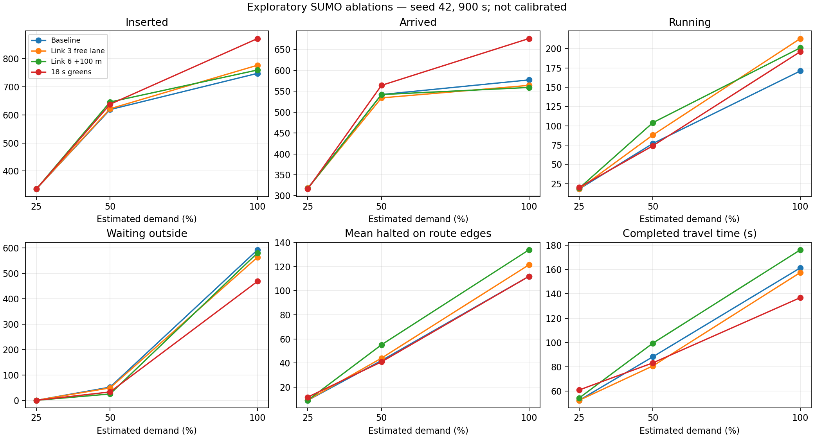

# Phase 3 exploratory environment — 2026-11-06

**Status: experimental model runs; calibration and Phase 3 validation gate are not complete.** No accuracy threshold was fixed, no calibration performed, and no independent validation or held-out test used. The model is Bangkok-informed and currently unsuitable for a validated Bangkok performance claim. In particular, the substantial uninserted queue and large detector discrepancies below require investigation before baselines or RL.

## Network and signals

The snapshot and build commands are in [sumo/README.md](../sumo/README.md). © OpenStreetMap contributors, ODbL 1.0. It was obtained on 6 Nov 2026, whereas traffic observations are historical 2016. The imported passenger-only network contains 56 ordinary edges and one joined static traffic-light controller. The target includes nodes `1672566448`, `269740352`, and `277363820` near 13.7187–13.7189 N, 100.5198 E. Imported OSM way tags indicate one-way South Sathorn `747478914` (4 lanes), Charoen Rat `295789573` (3), Surasak `39943703` (4), and North Sathorn `177961597` (4). These are source-map tags, not independent measurements of the 2016 layout. The five Link 1 sensor IDs versus four mapped lanes, and four Link 3 sensor IDs versus three mapped lanes, make a one-sensor-per-lane interpretation untenable without further evidence; sensors must not be assigned to lanes on this basis.

`netconvert --lefthand` marks the network as left-hand; automated tests confirm this, the four selected OSM one-way tags and lane counts, detector lane IDs and the continuity of each generated route. These checks demonstrate consistency with the current OSM import, not field validation of historical lane counts, stop lines, legal turns, detector-to-lane mapping or geometry. Three selected nodes and an additional crossing node were joined into one controller; lane connections were generated by SUMO and have not been independently verified against signs, archived plans or the source phase diagrams. A traffic light from outside the kept model was dropped. Import warnings include an ignored `no_right_turn` relation `18084970` with via node `480760398` (longitude 100.5151781, outside the retained bbox); public-transport objects and stop data were also discarded. The model covers passenger cars only, not buses, motorcycles, bikes or pedestrians. It does not establish safe real-world or pedestrian operations.

The generated fixed-time controller has a 90 s cycle: five 12 s green groups, each followed by assumed 4 s yellow and 2 s all-red. These are **simulation assumptions**, not observed historical timings. `scripts/check_phase3.py` checks every controlled link against the model's junction conflict matrix, rejects conflicting greens, and checks yellow and all-red states and durations. It cannot prove the underlying geometry or movement permissions are correct. With a graphical SUMO run, [screenshots around 90 s](../results/phase3_gui_90.png) and [151 s](../results/phase3_gui_151.png) show traffic at different positions; [sampled GUI state](../results/phase3_gui_samples.csv) records green, yellow and all-red states and vehicles moving. Image rendering can lag the sampled timestep; do not interpret an image as an exact signal-state timestamp. A 900 s simulated run reported zero SUMO collisions, not a real-world safety guarantee.

## Measured observations, estimated arrivals and simulated outputs

Only the complete 2 Jun 2016 07:00–07:15 local-time-assumed approach profiles are used. The Figshare observations are five-second counts summed by the authors' sensor groups into vehicles per 15 minutes. Their source timestamps lack offsets; Asia/Bangkok remains assumed. The physical detector locations were described as approximately 30 m from the junction in the data descriptor, but correspondence to SUMO lanes is not established; the model's loops are approximate per-lane measurement points, not a sensor-ID mapping. The flows count vehicles passing detector locations and are **not assumed to be measured boundary inflow**.

For a first sensitivity case, estimated boundary-arrival rate = observed 15-minute count × 4 × **0.8**. The factor is arbitrary, uncalibrated and is not an inferred measurement or an imputation. Traffic arrives at a constant rate, begins with an empty network and runs for 900 s with no warm-up or drain. All vehicles are SUMO passenger cars. Each approach uses one synthetic route (100% of that approach on that route); turning ratios, vehicle mix and demand temporal structure are not measured. Departures are constrained by the model and may queue outside the boundary. Seed 42 is used and the 9 June test data was not used.

| Approach | Observed detector counts / 15 min | Estimated boundary rate, vehicles/hour | Simulated approximate detector entries / 15 min |
|---|---:|---:|---:|
| Link 1, South Sathorn | 535 | 1,712 | 233 |
| Link 3, Charoen Rat | 204 | 652.8 | 55 |
| Link 5, North Sathorn | 549 | 1,756.8 | 245 |
| Link 6, Surasak | 387 | 1,238.4 | 98 |

The two detector columns are shown as a diagnostic, not a validated error metric: source and simulated detector locations/coverage are not matched, and initial queues, demand and signal plans differ. In the 900 s run SUMO loaded 1,341 scheduled vehicles, inserted 748, had 171 still running and 593 waiting to enter at the end; no teleport or collision was reported. The 593 are not represented in in-network queue statistics. This is a serious model/demand mismatch, not evidence that the real junction behaved this way.

As an initial sensitivity check only, increasing assumed all-red from 2 to 3 s while retaining 4 s yellow and the same seed/inputs gave 683 inserted and 658 waiting to enter; SUMO again reported zero collisions. This is one simulation seed and not a safety standard or calibrated parameter selection.

## Remaining gates

- Independently verify 2016-era road directions, lane connections, legal movements, phase compatibility, pedestrian treatment and suitable network boundaries. Do not equate current OSM with 2016 truth.
- Establish physical sensor correspondence and independent boundary inflow or a justified estimation model; inspect insertions, missing gaps, turning ratios, vehicle mix and queues. The 0.8 factor and one-route-per-approach assumption are placeholders.
- Define an engineering-supported acceptance threshold before using held-out results; calibrate on training days and assess independent validation days. The Jun 9 test set remains held out. There are no independent queue/travel-time targets established yet.
- Check realistic warm-up, horizon, spillback and controlled signal sensitivity; a single deterministic seed, 15-minute window and two clearance values are not sufficient evidence of stability or generalization.

Do not proceed to Phase 4 or RL until the user reviews this environment and the relevant topology, safety and calibration gates are addressed.

## Phase 3 insertion diagnostics — 2026-11-06

Each case scales the **estimated boundary rates** above by 25%, 50% or 100%; the observed detector counts are unchanged. SUMO 1.28.0 uses the existing network, signal, `departLane="best"`, `departSpeed="max"`, vehicle defaults, disabled jam teleport, seed 42 and 900 s horizon. Only flow rates change; deterministic flow departure schedules differ across cases and are not nested samples.

| Estimated demand | Loaded | Scheduled | Departed | Arrived | Running | Waiting to insert | Teleports | Discarded | Completed mean travel time (s) |
|---|---:|---:|---:|---:|---:|---:|---:|---:|---:|
| 25% | 336 | 336 | 336 | 318 | 18 | 0 | 0 | 0 | 52.52 |
| 50% | 671 | 671 | 619 | 542 | 77 | 52 | 0 | 0 | 88.29 |
| 100% | 1,341 | 1,341 | 748 | 577 | 171 | 593 | 0 | 0 | 161.33 |

Scheduled counts come from completed, unfinished and undeparted trip records and equal loaded for this horizon. Loaded = departed + waiting + discarded; departed = arrived + running. Collisions were zero in all cases. Arrivals are throughput within 900 seconds, not a steady-state rate. Mean travel time covers completed trips only, starts at insertion, and excludes departure delay, unfinished and undeparted vehicles; censoring, the empty start and absence of drain limit comparisons.

TraCI pending-vehicle snapshots, grouped by route origin edge:

| Estimated demand | Origin / approach | 180 s | 360 s | 540 s | 720 s | 900 s |
|---|---|---:|---:|---:|---:|---:|
| 100% | `747478914#3` / Link 1 | 13 | 53 | 93 | 134 | 172 |
| 100% | `295789573#0` / Link 3 | 0 | 0 | 1 | 21 | 38 |
| 100% | `1024938013#0` / Link 5 | 7 | 49 | 94 | 134 | 179 |
| 100% | `39943703#7` / Link 6 | 35 | 78 | 120 | 162 | 204 |
| 50% | `39943703#7` / Link 6 | 5 | 17 | 28 | 40 | 52 |

Other 50% origins and all 25% origins had no pending vehicles at these snapshots. The full-demand queue grows throughout, especially at Links 1, 5 and 6; at 50%, only Link 6 retains a queue. Demand exceeds simulated insertion/service capacity, but these runs do not isolate signal timing, geometry, route allocation, lane choice or spillback as causes, and do not establish real-world capacity or calibrated demand.

Every adjacent route edge has passenger lane connections and SUMO reported no route errors. Link 1 and Link 5 retain four same-index connections across their routes. Link 3 has three lanes at its 524.39 m origin but its modeled final left turn connects only from lane 0 (to lanes 0 and 1). Link 6 has four lanes until its final left turn, where only lanes 0 and 1 connect. `departLane="best"` selects for the route; nominal lane count does not imply all lanes serve its turn. Connectivity in the model is not proof of 2016 turn legality or lane use.

Origin lengths/lane counts: Link 1 24.43 m / 4, Link 3 524.39 m / 3, Link 5 50.24 m / 4, Link 6 32.62 m / 4. Other short route edges include `295789573#1` (2.81 m), and `751476541`, `1136400026`, `39943703#9` (0.20 m each). Short modeled segments and limited boundary storage warrant geometry and spillback review; their causal effect is not established. The network root is `lefthand="true"`, consistent with its `netconvert --lefthand` build; this does not validate historical geometry.

Reproduce with `unset PYTHONPATH; .venv/bin/python scripts/diagnose_insertion.py`. See [scenario statistics](../results/phase3_demand_sensitivity.csv) and [origin snapshots](../results/phase3_insertion_by_origin.csv). The script checks vehicle accounting and final origin totals; two executions produced identical CSV hashes. No safety constraints were relaxed and no held-out test data was used.

## Phase 3 lane-choice experiment and calibration readiness — 2026-11-06

The 593 pending vehicles cannot responsibly be eliminated by treating detector counts as boundary arrivals or inventing turning proportions. To test an insertion change without changing demand, routes, network, signal timing, clearance, seed, or 900 s horizon, `scripts/compare_insertion_lanes.py` compares the existing `departLane="best"` with `departLane="free"` at three demand scales. These are controlled exploratory scenarios, not alternative estimates of observed demand. Each run checks loaded/departed/waiting/discarded and departed/arrived/running accounting, and pending vehicles by origin. The full results are in [lane comparison](../results/phase3_lane_comparison.csv).

| Demand | Lane choice | Loaded | Departed | Arrived | Running | Pending | Collision / teleport / discarded |
|---|---|---:|---:|---:|---:|---:|---|
| 25% | best | 336 | 336 | 318 | 18 | 0 | 0 / 0 / 0 |
| 25% | free | 336 | 336 | 318 | 18 | 0 | 0 / 0 / 0 |
| 50% | best | 671 | 619 | 542 | 77 | 52 | 0 / 0 / 0 |
| 50% | free | 671 | 629 | 538 | 91 | 42 | 0 / 0 / 0 |
| 100% | best | 1,341 | 748 | 577 | 171 | 593 | 0 / 0 / 0 |
| 100% | free | 1,341 | 781 | 528 | 253 | 560 | 0 / 0 / 0 |

At full demand, `free` shifts 33 vehicles from the insertion queue into the network but 49 fewer arrive by the horizon; it is not an established fix. Pending by Link 1/3/5/6 changes from 172/38/179/204 to 178/0/182/200. At 50%, all pending vehicles remain at Link 6. The largest sum of sampled halted-vehicle counts (one snapshot every 10 s, excluding internal edges) is on Link 3's `295789573#0`: 3,330 with `best`, 5,789 with `free` at full demand. This is a snapshot-based congestion indicator, not vehicle-seconds or independent proof of a single bottleneck. Link 3's route uses only lane 0 at its final turn, and Link 6 uses lanes 0–1; short upstream edges, service time and downstream spillback may also constrain insertion. Signalized route movements and clearance remain as documented above. `free` may insert into lanes that are less suitable downstream, so no change to the default scenario is justified by the smaller pending count alone. The 593-vehicle problem remains unresolved at full estimated demand.

**Realism and readiness:** The network is left-hand and the modeled signal conflict/clearance checks pass; zero reported collisions and teleports in these short runs do not validate actual safety. Current-map geometry, turn restrictions, the one-turn-per-approach allocation, lanes used, traffic mix, boundary arrival rates, signal program, detector positions and timezone remain unverified for 2016. Constant flows, empty start and no drain make the 15-minute outcomes transient; completed-trip travel time excludes pending and unfinished vehicles. This is a Bangkok-informed exploratory simulation, not a calibrated model and not ready for defensible calibration against these counts as though they were boundary flows.

Before calibration, establish historical geometry and permitted movements, detector-to-lane/location mapping and observed signal timing/clearance; obtain defensible upstream arrival and turning data plus independent queue or travel-time measurements. Define warm-up, horizon and drain, stochastic replication, objective metrics and acceptance thresholds before tuning. Fit only on the designated training data, evaluate on a separate validation day, and reserve 9 June 2016 test data for the final locked evaluation. Record missing data and uncertainty; do not label the model calibrated unless predefined criteria and independent validation are met. Stop before Phase 4 for review.

Reproduce: `unset PYTHONPATH; .venv/bin/python scripts/compare_insertion_lanes.py`. No 9 June observations are read by this experiment.

## Phase 3 controlled bottleneck ablation — 2026-11-06

The baseline is the existing case: the original network and routes, seed 42, 900 s empty start, no drain, `best` departure lane and 12 s greens with 4 s yellow/2 s all-red. Each temporary intervention changes one assumption, at 25%, 50%, and 100% of the **already estimated** demand. No baseline model files were changed and no 9 June test data was read. The interventions are sensitivity probes, not proposed historical values:

- **Link 3 free lane:** only Link 3's `departLane` changes from `best` to `free`; all routes and final turning connections remain identical. This probes insertion lane choice, not the effect of adding a legal turning lane.
- **Link 6 storage:** only the modeled length attribute of every lane on short origin `39943703#7` increases by 100 m, from 32.62 m to 132.62 m. The lane shape and rest of the network remain unchanged. This deliberately artificial virtual-storage probe is not a geometry correction and does not establish real road length; it also increases simulated driving distance. The 100 m is a diagnostic contrast, not a measured estimate.
- **Longer greens:** each of the five green durations changes from 12 to 18 s; sequence and green states are unchanged. Yellow remains 4 s and all-red 2 s; the cycle grows from 90 to 120 s and the green share from 60/90 to 90/120. Thus the contrast tests this combined change in cycle and green share, not either effect independently. The 18 s value is a diagnostic contrast, not observed timing or a recommendation. Every generated network passes the conflict-matrix and clearance checks; these checks do not establish field safety.

### Before/after metrics

Queue is the **mean number of halted vehicles** (SUMO speed below 0.1 m/s) on the edges of the four modeled routes before their final destination edges, sampled every 10 s; it excludes internal junction lanes, destination edges and vehicles waiting outside. Individual edge/lane results, including snapshot maxima, are in [lane queues](../results/phase3_lane_queues.csv). Travel time is the mean of **completed** trips from insertion to arrival; it excludes departure delay and unfinished or undeparted vehicles. An apparently shorter mean may reflect which trips completed. The other counts are end-of-run values; loaded = inserted + waiting + discarded and inserted = arrived + running. All 12 runs report zero collisions, teleports and discarded vehicles, which is not proof of real-world safety.

| Demand | Case | Inserted | Arrived | Running | Waiting | Mean halted | Completed travel (s) |
|---|---|---:|---:|---:|---:|---:|---:|
| 25% | Baseline | 336 | 318 | 18 | 0 | 9.16 | 52.52 |
| 25% | Link 3 free lane | 336 | 318 | 18 | 0 | 9.29 | 52.53 |
| 25% | Link 6 storage | 336 | 317 | 19 | 0 | 9.20 | 54.41 |
| 25% | Longer greens | 336 | 316 | 20 | 0 | 11.80 | 61.02 |
| 50% | Baseline | 619 | 542 | 77 | 52 | 42.11 | 88.29 |
| 50% | Link 3 free lane | 622 | 534 | 88 | 49 | 44.09 | 80.76 |
| 50% | Link 6 storage | 646 | 542 | 104 | 25 | 55.16 | 99.45 |
| 50% | Longer greens | 638 | 564 | 74 | 33 | 41.03 | 83.28 |
| 100% | Baseline | 748 | 577 | 171 | 593 | 111.81 | 161.33 |
| 100% | Link 3 free lane | 777 | 564 | 213 | 564 | 121.38 | 157.51 |
| 100% | Link 6 storage | 760 | 559 | 201 | 581 | 133.80 | 176.11 |
| 100% | Longer greens | 872 | 676 | 196 | 469 | 111.86 | 136.86 |

### Lane and edge evidence

At full baseline demand, the mean halted counts on Link 1's `747478914#4` lanes 0/1/2/3 are 6.09/6.03/5.93/5.91 vehicles. Link 5's short origin `1024938013#0` lanes 0/1/2/3 average 4.16/4.27/4.16/4.22. Their full-demand external queues are 172 and 179, respectively; this indicates multi-lane accumulation in these modeled routes rather than a single observed bad lane.

Link 3's long `295789573#0` lane 0 averages 32.70 halted vehicles (snapshot maximum 67), versus 4.24 on lane 1 and 0.06 on lane 2. Its final modeled turn from `295789573#1` connects only from lane 0. Changing only its departure choice to `free` removes its final external queue (38 to 0), but total arrival falls 577 to 564 and mean route halted rises 111.81 to 121.38. This supports sensitivity to insertion/lane allocation under the assumed one-route demand; it does not prove the turning restriction is correct or directly measure what would happen with an additional permitted turn lane.

Link 6's `39943703#8` lanes 0/1 average 3.41/3.38 halted, and its origin lanes 0/1 average 3.04/3.02 while lanes 2/3 average zero. Its modeled final turn uses lanes 0 and 1 only. The external queue is already 52 at 50% demand. Extending virtual origin storage reduces that queue to 25, with arrivals unchanged at 542 and running rising 77 to 104; this shows that limited modeled boundary storage affects *where* the queue is represented. It does not establish that extending the real road would improve throughput. At full demand the storage probe lowers total waiting by 12 but lowers arrivals by 18 and raises mean halted by 21.99.

The longer-green intervention raises full-demand arrivals by 99 and reduces external waiting by 124, while mean halted remains nearly unchanged and 469 still wait. This supports sensitivity to the modeled signal service/cycle, not a validated real-world timing or proof that timing alone caused the backlog. Longer greens worsen completed-trip mean and arrivals at 25% in this finite window. Effects also depend on the joined controller and synthetic routes. All conclusions are confined to this simulation and single seed; 15 minutes, empty start, no drain, unspecified 2016 turn legality, inaccurate network boundaries and a passenger-only fleet limit realism. No controlled experiment here changes the turning connections: adding an unverified connection would alter the conflict/safety model, so independent lane/turn evidence is needed before testing it.

Reproduce from the project root: `unset PYTHONPATH; .venv/bin/python scripts/phase3_ablation.py`. Plot with `python3 scripts/plot_phase3_ablation.py` (system Python with matplotlib); output data are [scenario metrics](../results/phase3_ablation.csv) and [lane queues](../results/phase3_lane_queues.csv). The experiment checks accounting and each generated network's modeled signal safety. The two data CSVs were reproduced byte-for-byte. Historical network, signal, detector mapping, measured boundary flows, turning shares and independent targets still need evidence before calibration or validation; Phase 4 remains paused for review.
